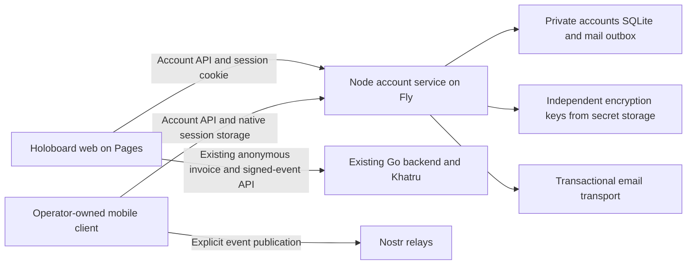

# Native email accounts

Status: first-version contract and private local developer preview in `accounts/`.
Verified accounts, encrypted stable identities, kind-1 signing, explicit export,
transactional recovery, encrypted mail delivery, the client SDK, loopback TLS
service, browser forms and offline restoration are implemented and tested locally.
The [first-flow plan](superpowers/plans/2026-10-21-native-accounts-first-flow.md)
records the scope, including outstanding native-device acceptance.
Holoboard integration and production activation remain separate work.
See [the account direction](nostr.md#paid-root-posts).

For custody, transport distinctions and pinned existing implementations, see
the [key custody and signing research](accounts-custody.md). Better Auth is the
selected account component; it is not the author-key vault or a NIP-46
implementation. The operation-level source comparison supports this library
boundary, not a claim of superior security or lower maintenance cost. Divine
Keycast can provide headless accounts behind an application-owned UI if adopting
a complete account/signing service becomes preferable to an embeddable library.

## Purpose and scope

Provide email/password onboarding for applications using Nostr identities,
with an application-owned interface and server-held author keys. Support web
and native mobile integration without requiring a relay, browser extension or
specific frontend framework. Holoboard is the first integration.

Use a TypeScript server library for a supported Node.js LTS runtime, a
small standalone HTTP service using that library, and a separate TypeScript
client SDK. A Node application can embed the library. Holoboard's Go backend
can coexist with the service without importing Node code. This recommendation
prioritizes reuse across clients; an embedded Go implementation would avoid the
additional service but require a different server implementation.

One installation owns one application's account domain and private database.
First-version clients are applications controlled by that operator, including
its own web and mobile clients. This is not a shared login provider for arbitrary
third-party applications. Embedding the library elsewhere creates independent
accounts unless shared identity is separately designed.

The first version includes registration, email verification, login, bounded
server-side sessions, password change and recovery, one stable Nostr identity
per account, scoped event signing, explicit key export and session revocation.
Identity creation follows verified login. Importing existing author keys,
shared accounts across operators, OAuth/OIDC provider behavior, NIP-46 hosting
and message encryption are follow-up scope. Existing external signers remain
available independently of these accounts.

## Ownership and dependency policy

Own the integration contract, SDK, account-to-identity relationship, permission
policy, UI, email templates and recovery orchestration. Keep authentication,
storage, mail and key encryption behind explicit adapter boundaries. Do not
expose dependency-specific database models or errors as the public contract.

Dependencies must preserve required behavior. Use an adapter, select another
component or implement application orchestration when a framework imposes an
unwanted UI, session, identity or deployment model. Do not discard requirements
to fit a framework. Use established libraries for cryptography, key generation,
signatures, password hashing and token generation. Do not invent cryptographic
formats or authentication protocols to avoid an inconvenient dependency.

The service wrapper handles configuration, HTTP lifecycle and operations. It
must not contain a second implementation of the library's account logic. The
browser SDK has no imports from the server package or secret-key storage code.
Package names and an independent repository are not required to settle this
contract; do not publish packages during implementation review.

## Deployment and integration examples

For Holoboard, propose a dedicated controlled HTTPS account origin, for example
`accounts.holoboard.space`. This is a proposed address, not provisioned
infrastructure. The service owns its own persistent volume, private SQLite file
and secrets. It does not share a Fly volume or database writer with the Go
relay. Pages uses explicit credentialed fetches to the account origin. Keep UI
and account API under controlled same-site domains.

The Go invoice API continues accepting verified signed events through its
existing path and does not need the account cookie. Signing returns the exact
signed event; the existing payment flow persists its private snapshot and
publishes only after settlement. Account-service downtime must not prevent
paying or recovering existing invoices.

A Node application can instead mount the same account handler at a configured
prefix on its own HTTPS origin. There is one set of account operations in both
modes. Installation configuration supplies the base URL, trusted web origins,
mobile return URLs, database, encryption keys, mail adapter and signing policy.
A minimal example should work without Holoboard, React or Khatru.

Khatru's current public CORS wrappers must not surround private account routes.
A dedicated account origin avoids changing relay startup for the proposed
service. An embedded-Go alternative would need a top-level private HTTP route
before both relay CORS wrappers, preserving timeouts and WebSocket shutdown.
Arbitrary Pages preview domains are not approved account origins; use controlled
staging domains or an explicitly reviewed same-origin proxy.

## Public HTTP contract

The table below specifies logical operations and proposed paths, not implemented
endpoints or a requirement to wrap every auth-library route. Prefer reviewed
Better Auth endpoints for ordinary account operations, with the SDK mapping
their names, results and errors. Keep our identity/signing endpoints separate.
Document the exact wire contract against the pinned dependency during the first
integration; preserve cookie, privacy, verification and revocation requirements
when choosing native routes or response hooks. The prefix is configurable;
examples use `/v1`. Our mutation endpoints use JSON over HTTPS.
Protected routes derive the account solely from the validated session. Account
IDs, public keys, operation labels and client metadata supplied by callers are
not authority to act for another account.

Set an initial 64 KiB JSON-body limit, with tighter field limits and a 16 KiB
content limit for Holoboard root posts. Reject unknown authority-bearing fields
such as caller-supplied `pubkey`, `id` or `sig` in unsigned templates. Validation
must not trim, reorder or otherwise rewrite the requested event. Account and
signer responses use `Cache-Control: no-store`; do not cache them in the PWA.

| Method and path | Request | Success and required behavior |
| --- | --- | --- |
| `GET /v1/capabilities` | None | `200`, contract version, supported transports and configured signer operations; no account data |
| `POST /v1/accounts` | `email`, `password`, optional `displayName` | `202`, generic accepted result, queue verification; no author key or login session |
| `POST /v1/email/verification/request` | `email` | `202`, generic result for eligible and ineligible addresses |
| `POST /v1/email/verification/complete` | `token` | `200`, verify email; no automatic login or publication; repeat confirmation cannot create another identity |
| `POST /v1/session` | `email`, `password` | `200`, establish a new session after verification; return account, identity state and expiry; session credential is carried by cookie |
| `GET /v1/session` | Session | `200`, live account/session summary, identity state and capabilities; no session token in JSON |
| `DELETE /v1/session` | Session | `204`, revoke current session and clear its cookie; repeated logout is safe |
| `GET /v1/sessions` | Session | `200`, opaque management IDs, creation/expiry and current-device marker; never session credentials |
| `DELETE /v1/sessions/{id}` | Session | `204`, revoke an owned session; cross-account IDs cannot revoke anything |
| `POST /v1/sessions/revoke-all` | Session, current `password` | `204`, revoke all account sessions, including the current one; explicit confirmation in the UI |
| `POST /v1/password/recovery/request` | `email` | `202`, generic result and eligible recovery email |
| `POST /v1/password/recovery/complete` | `token`, `newPassword` | `200`, consume token once, change password and revoke all sessions atomically; require login again; preserve author key |
| `POST /v1/password/change` | Session, `currentPassword`, `newPassword` | `200`, change password and revoke all sessions; require login again; preserve author key |
| `GET /v1/identity` | Verified session | `200`, stable public key and capabilities after committed provisioning; never a private key |
| `POST /v1/identity/sign` | Verified session, exact event `template` | `200`, validated signed event; never publication, wallet access or payment |
| `POST /v1/identity/export` | Verified session, current `password` | `200`, public key and `nsec` for this explicit operation only; disable caching and telemetry |

Registration needs no real name. Any display name is private account metadata
until the user explicitly publishes a Nostr profile. Normalize email through the
auth adapter consistently; do not invent provider-specific address equivalence.
Verification and recovery links lead to operator-owned pages. Configure allowed
return URLs at installation time rather than accepting arbitrary redirect URLs.
Strip consumed link tokens from navigation and never include them in logs or
analytics. Keep recovery/verification pages free of third-party tracking.

Protected responses use a stable account ID, an identity state (`ready`,
`provisioning` or `unavailable`) and a public key only when known. A failed
provisioning attempt can leave a valid verified session, but signing/export must
fail until identity availability is established. Retrying must reuse any
committed key. Signing, export and identity reads recheck account status.

Errors use `{ error: { code, message, retryable }, requestId }`. The request ID
is safe diagnostic metadata. Use `400 INVALID_INPUT`, `401 UNAUTHENTICATED`,
`403 EMAIL_UNVERIFIED` or `PERMISSION_DENIED`, `413 REQUEST_TOO_LARGE`,
`429 RATE_LIMITED` with `Retry-After`, and `503 IDENTITY_UNAVAILABLE` or
`TEMPORARILY_UNAVAILABLE`. Invalid credentials use one generic login error;
recovery and registration do not disclose account existence. SDK error codes
must not expose raw framework messages, credentials, ciphertext or stack traces.

### Implemented account and signing slice

The initial server mounts reviewed Better Auth 1.7.12 routes directly under the
configurable `/v1/auth` prefix. The logical table above still describes the wider
target contract; it is not an additional set of implemented auth endpoints.

| Wire path | Method and body/query | Current result |
| --- | --- | --- |
| `/v1/auth/sign-up/email` | POST `email`, `password`, required private `name`, optional `callbackURL` | `202 { accepted: true }` for new and duplicate accounts; no session |
| `/v1/auth/send-verification-email` | POST `email`, optional `callbackURL` | Generic `202 { accepted: true }` |
| `/v1/auth/verify-email` | GET `token`, optional `callbackURL` | Native status/result or redirect to the exact allowed page; no automatic login |
| `/v1/auth/sign-in/email` | POST `email`, `password`, optional `callbackURL` | Native user/redirect fields with top-level token removed; cookie establishes session |
| `/v1/auth/get-session` | GET with cookie | Native `{ user, session }` or `null`, with `session.token` removed |
| `/v1/auth/request-password-reset` | POST `email`, optional `redirectTo` | Generic `202 { accepted: true }` |
| `/v1/auth/reset-password` | POST `token`, `newPassword` | Native `{ status: true }`; database token consumption, password update and all-session revocation |
| `/v1/auth/sign-out` | POST `{}` with cookie | Native success; preserve all cookie deletion headers |

`callbackURL` and `redirectTo` match complete configured return URLs, without
arbitrary paths or query strings. Missing values use the first configured page.
Reset mail points directly at that page with the token; the native GET reset
callback and password verifier are not exposed. The application must remove
consumed tokens from navigation. `rememberMe: false` is rejected to retain one
fixed seven-day session policy. Email verification uses expiring signed JWTs;
password reset records and sessions live in SQLite without secondary storage.

Error responses use the envelope above. Native unverified login maps to
`403 EMAIL_UNVERIFIED`, generic credential failures to `401 UNAUTHENTICATED`,
invalid native input to `400 INVALID_INPUT`, and internal errors to
`503 TEMPORARILY_UNAVAILABLE`. Ingress also uses `404 NOT_FOUND`,
`408 REQUEST_TIMEOUT`, `415 UNSUPPORTED_MEDIA_TYPE`, `431 REQUEST_HEADERS_TOO_LARGE`
and the documented 413/429 codes. Missing sessions return native `200 null` on
`get-session`; private extension routes return 401. The SDK normalizes these
native success fields into its application contract.

Custody installations use a bounded encrypted SQLite mail outbox. Authentication
callbacks await local enqueue; an explicit private worker performs external
delivery separately. Provider failures and queue saturation preserve generic
responses. A local enqueue failure increments a private operator counter, so
acceptance is not proof of queue commit or delivery. Malformed input remains an
error. Payloads use the custody keyring with a separate `account-mail` JWE purpose,
expire with their links and have persisted leases and bounded retry attempts.
The earlier auth-only compatibility mode retains best-effort delivery; it is
not the full account service configuration.

`initializeAccountDatabase` explicitly creates a new private database and refuses
existing files. Opening the server never migrates existing data. The factory's
private-route extension shares the bounded HTTP ingress and supplies our minimal
`AccountSession`, read from the live session, independently of caller account IDs.
The identity routes use the same ingress and live verified session. Their fixed
paths are `GET /v1/identity`, `POST /v1/identity/sign` and
`POST /v1/identity/export`, independently of the configurable auth prefix.
Identity reads return the session-derived account ID, public key and supported
capabilities. Only kind 1 is implemented; export is disabled unless explicitly
enabled and requires the current password on every request. The server and SDK
verify the exact returned event and signature without relying on a cached
verification marker. No operation publishes an event or accesses a wallet.

Real HTTPS recovery tests cover separate device cookie jars, session revocation,
one concurrent reset winner and a SQLite failure that rolls back token
consumption, password update and all-session revocation together. Restart checks
include a separate Node process. Full password change and device-management
routes remain outside this first slice. See the
[workspace reference](../accounts/README.md) for exact limits and commands.

## Client SDK contract

The SDK accepts a service base URL and a transport. The web transport uses
credentialed fetch; the native transport supplies its cookie storage adapter.
There is no required global `window.nostr`, DOM object, React provider or browser
storage API in the shared SDK core.

The public account client exposes the operations in the HTTP table. Its signer
adapter exposes `getPublicKey()` and `signEvent(template)`, matching Holoboard's
existing `ConnectedSigner` boundary in
[connections.ts](../web/src/lib/connections.ts). These operations also resemble
the basic browser signer methods in [NIP-07](https://github.com/nostr-protocol/nips/blob/master/07.md);
that resemblance does not make the SDK a browser extension or inject it into
other websites.

The SDK snapshots the requested event and expected account, validates the
returned signature, public key, event ID and exact template, and rejects a late
response after logout or account switching. A timeout permits explicit retry of
the same template after checking the account. Never silently change
`created_at`, publish an event or retry an export. An abort stops client handling;
it cannot retract a signature or publication that has already happened.

## Web and mobile sessions

Recommend one opaque server-side session model for both web and native clients,
with cookie transport in version one. Use fixed seven-day expiry without silent
sliding renewal initially. The local implementation uses this fixed limit.
A later renewal design must retain server-side revocation and a
bounded absolute lifetime.

Web uses a host-only `HttpOnly`, `Secure`, `SameSite=Lax` cookie. No session
credential or author secret goes into localStorage, sessionStorage or ordinary
JSON responses. Apply exact origin/return-URL allowlists, JSON-only mutation
routes and CSRF safeguards to the actual public handler chain. CORS is not
account authorization. Do not globally disable origin or CSRF checks to make a
native client work.

Native clients maintain a session cookie jar over HTTPS and persist the session
credential using platform-protected storage. An Expo example can use the
[documented SecureStore integration](https://better-auth.com/docs/integrations/expo).
A Swift or Kotlin client needs a cookie-jar/storage adapter and direct API calls;
there is no requirement to run Node.js on the device. SDK code must support
multiple `Set-Cookie` headers, cookie expiry and explicit deletion correctly.

Do not label Swift/Kotlin integration verified on the strength of an Expo
example. First acceptance requires a runnable native example that logs in,
survives an app restart, signs, expires and observes remote revocation. Test
verification/recovery return links and native requests with the configured
origin policy. Native transports can send the operator's configured allowed
origin explicitly; treat that header only as a CSRF signal, never as proof of
client identity. Arbitrary custom URL schemes are not proof of identity either.

Login creates a new session credential. Every sign/export request checks the
live session database and account state; revoke before reporting successful
logout/reset. Requests authorized before revocation may already have produced a
signature. Document that boundary and reject all requests admitted after the
revocation commit. Clear local account/signer state independently of the wallet.

Export requires a current password on each request. Reuse the auth component's
password verifier through a private adapter. This avoids introducing a separate
reauthentication-token protocol or treating possession of a recent session as
sufficient for export. Rate-limit password verification as well as login.

## Signing permissions and compatibility

Deny signing unless the installation policy and the authenticated session permit
the operation. A caller's operation label is a hint; validate the event itself.
Keep kinds, target origins and any limits in explicit installation policy.
Account login is not unrestricted permission to sign any event.

Holoboard's initial policy needs the following operations, subject to the
existing feature flags and explicit user actions:

| Kind | Purpose | Validation boundary |
| --- | --- | --- |
| `1` | Root posts, quotes and legacy replies | Exact content, tags and timestamp; bounded payload; the application retains root/reply context |
| `1111` | Discussion comments | Validate required parent/root context through the application's existing reply rules |
| `9734` | Optional public author zap request | Validate recipient, event and amount fields; signing does not send funds |
| `24242` | Blossom media authorization | Approved operation/server, file hash and expiry |
| `27235` | Nostr HTTP authorization for media requests | Approved exact URL, method, payload hash when applicable and short time window |

The kind list comes from Holoboard's current
[connection permissions](../web/src/lib/connections.ts),
[root composer](../web/src/lib/boardComposer.ts),
[media uploader](../web/src/lib/composerMedia.ts) and
[author support](../web/src/lib/support.ts). URL/method binding for kind `27235`
is described in [NIP-98](https://github.com/nostr-protocol/nips/blob/master/98.md).
Validate these operations without fetching arbitrary caller-provided URLs on
the account server. Media origins outside installation policy require an
explicit policy change or a reviewed permission flow.

Other applications can configure a different policy without importing Holoboard
code. Unknown kinds and unsupported encryption methods return an explicit
permission/capability error. Initial capabilities do not promise profile editing,
DM decryption or complete compatibility with every Nostr client. Current
Holoboard notification transport uses the relay's identity independently of the
account signer.

[NIP-46](https://github.com/nostr-protocol/nips/blob/master/46.md) is an optional
future transport for already authorized remote clients. Hosting it adds pairing,
per-client permissions, revocation, relay connections and pending-request
handling. It is not required for direct account API integration. Third-party
clients must not receive the user's account password. Adding NIP-46 requires
its own acceptance against supported clients; no generic SSO is implied.

## Stable identity, custody and recovery

This is custodial storage: the server can decrypt and sign with the author key.
The password authenticates access; an independent server-held encryption key
protects persisted author secrets. Email recovery therefore controls access to
the existing identity. Neither a password reset nor auth-library replacement
may generate a replacement author key.

Provision after verified login, using one transaction and a unique immutable
account-to-identity mapping. Commit the encrypted key, public key and assigned
identity marker before exposing that identity. Concurrent requests reuse the
winning committed record. A known identity with a missing key row, missing
encryption key or invalid ciphertext is unavailable, never unprovisioned.

For TypeScript, recommend the established
[jose Compact JWE implementation](https://github.com/panva/jose/blob/main/docs/jwe/compact/encrypt/classes/CompactEncrypt.md)
with fixed `dir`/`A256GCM` algorithms and library-generated randomness. Use the
standard [JWE format](https://www.rfc-editor.org/rfc/rfc7516.html), not custom
ciphertext framing. Bind the installation ID, immutable account ID, purpose and
format version in the authenticated protected header. After authenticated
decryption, check those fields against the requested record before using the
key; check that the derived public key matches the assigned one. Resolve `kid`
only from configured secret keys, with explicit algorithm allowlists and no
network key lookup.

Keep encryption keys separate from the account database, auth-session secret,
relay identity and wallet credentials. New records use the active key ID;
rotation retains old decryption keys while existing records and supported
backups depend on them. Export returns the assigned identity after fresh
password verification. Disabling export is a deliberate application policy,
not a limitation inherited silently from an auth dependency.

Use a consistent SQLite backup, separately protected encryption-key backups
and a restore runbook. Backups have a recovery point: keys created after the
last recoverable backup cannot be promised recoverable. Define the recovery
point objective before activation and explain unsupported recovery explicitly.
Restore into isolation, revoke restored sessions/tokens and reconcile assigned
identities before reopening provisioning. Email verification uses stateless
signed JWTs, so deleting database token records is insufficient: require a fresh
authentication secret and enforce the restored installation's secret binding.
Invalidate restored password credentials and require native email recovery
before another login, preventing a backup from reviving an obsolete password.
Keep the Nostr encryption keyring independent of this account recovery.
An older backup must not silently remint a key for an email whose identity is
missing. Preserve an independent
assignment inventory for that reconciliation; it contains no author secrets.
Keep registration and provisioning quarantined while inventoried assignments
are missing from recovered account/key records, including accounts absent from
the backup. Inventory persistence and restore reconciliation belong in the
implementation, not just test fixtures. A local inventory directory requires
separately durable storage/backup before production recovery can rely on it.

The library supplies consistent backup, isolated restore, reconciliation and
atomic rewrapping of current identity and outbox ciphertext. The
[offline recovery runbook](../accounts/docs/recovery.md) documents their public
APIs and runnable maintenance commands. Schema 4 initializes fresh installations
only; earlier preview schemas need separately reviewed migration tooling.

## Dependency fit review

These components are pinned and exercised together in the private workspace.
The [workspace reference](../accounts/README.md#pinned-dependencies-and-platforms)
records versions, advisory dates, licenses and the validated development platform.
Local compatibility and source review do not constitute a security audit or
production deployment acceptance. None requires a hosted login provider or an
external branded login window.

| Responsibility | Candidate and observed fit | Configuration or code owned by us |
| --- | --- | --- |
| Accounts | Better Auth supports credentials, verification, reset, custom mail and own UI | Stable public API adapter; no automatic signup login; verified-email gate; generic errors; pseudonym-only display name |
| Passwords | Better Auth has a configurable hash/verify interface | Use `@node-rs/argon2` Argon2id through that interface; benchmark and bound concurrency rather than copying sample parameters |
| Sessions | Better Auth supports database sessions and explicit revocation | Fixed expiry; no cookie cache or secondary session store initially; live checks for signing/export |
| Native transport | Better Auth documents Expo cookie handling | Shared HTTP contract plus platform storage adapters; actual native acceptance; no bearer plugin or custom JWT system by default |
| Private persistence | Better Auth supports SQLite via its built-in adapter | Start with `better-sqlite3`, private identity/outbox tables and reviewed versioned SQL; verify transaction behavior and native packaging |
| Nostr keys/signatures | `nostr-tools` provides generation, signing and verification | Account binding, operation validation, exact-event checks and no implicit publication |
| At-rest encryption | `jose` provides authenticated JWE encryption/decryption | Configured key loading, record binding, rotation and restore policy |
| Email | Better Auth accepts application mail callbacks | Branded templates, bounded durable outbox, transport adapter, retries and no credential/token payload logging |

Encrypt token-bearing outbox payloads with a separate encryption purpose, expire
them with their links and avoid indefinite retention. Keep contact addresses and
delivery errors out of public diagnostics. An accepted registration/recovery
request does not promise that an external mail provider has delivered the email.

The following integration findings determine whether Better Auth is acceptable:

- Reset session revocation is opt-in. Configure it explicitly and verify
  [transactional password reset](https://better-auth.com/docs/authentication/email-password#revoking-sessions-on-password-reset)
  with the chosen adapter. Use database-backed verification records and sessions.
- Session caches can delay revocation. Disable them in the initial deployment;
  sensitive operations must query live state. See
  [session management](https://better-auth.com/docs/concepts/session-management).
- Calling server-side `auth.api` does not apply the HTTP rate limiter. Our public
  facade must apply its own shared limits before delegating. See
  [rate limiting](https://better-auth.com/docs/concepts/rate-limit).
- General endpoint hooks and database after-hooks are extension points, not
  proof that identity creation is part of an auth transaction. Keep provisioning
  idempotent and transactional in our identity store. See
  [database hooks](https://better-auth.com/docs/concepts/database#database-hooks).
- A post-reset callback can fail after credentials have changed. Critical
  revocation must complete in the reset transaction, not depend on an after-hook.
  Durable noncritical email work can be queued separately.
- The server-only password verifier exists in current
  [password-route source](https://github.com/better-auth/better-auth/blob/main/packages/better-auth/src/api/routes/password.ts).
  Confirm its supported API in the pinned release before exposing our export
  endpoint; never expose the framework's internal endpoint directly.
- The facade must preserve cookies, origin checks and reset/verification behavior
  when mapping our contract to the framework. Mount only reviewed routes;
  unreviewed framework routes must not bypass our facade. Refer to
  [the security model](https://better-auth.com/docs/reference/security).

Runtime tests establish transactional reset, explicit export verification and
stable identity behavior for the pinned local adapter. Native device storage
and production operation still need their own acceptance. If an adapter fails
those requirements, replace it while preserving the contract. Do not rewrite
password reset/session machinery solely for uniformity.

## Operations and acceptance

The service must fail startup when its configured database, active encryption
key or auth secret is missing. Runtime key failures return explicit unavailable
errors. Support lookup-only access to the Go payment backend during account
feature rollback. Do not migrate the public board ledger into the account store.

Use reviewed migration files; do not run automatic production schema migrations
on startup. Adding a dependency is not permission to migrate existing data,
provision an external service, publish packages, send real mail or deploy.

The current Go Fly configuration requests 256 MB. That is not a measured budget
for Node, Argon2id and SQLite. Pin one supported runtime and dependency set,
check advisories and licenses, and measure login/signing latency, idle memory,
hashing concurrency and restart behavior before selecting account-service
resources. Set ingress/body limits, account/IP rate limits and trusted proxy
handling on the real public request chain. Account logs must exclude emails,
passwords, session/recovery credentials, plaintext keys and private event bodies.

Acceptance before activation:

1. Minimal embedded Node and standalone-service integrations use the same API.
   Direct HTTP calls work without the SDK and neither example imports Holoboard.
2. A real web client and one native example register, verify, log in, reload or
   restart and sign the exact requested event with a stable public key. Exercise
   configured staging origins, CORS, CSRF and native return URLs.
3. Concurrent initial provisioning exposes one identity. Lost keys, invalid
   ciphertext and unavailable storage fail without replacement identities.
4. Password change/reset rejects the old password and reused recovery tokens,
   revokes all sessions and preserves the public key. Inject a database failure
   to verify all-or-nothing credential/revocation behavior.
5. Export requires both a live session and the current password; the exported
   key reproduces the account public key. Ordinary responses contain no secret.
6. Each enabled signing operation passes its application policy; unauthorized
   kinds, account substitution and mismatched returned events fail. No signing
   request sends funds or publishes. Late responses cannot change active state.
7. Session expiry, per-device logout and remote revocation stop new signatures.
   No cookie/session cache or facade bypass preserves revoked access.
8. Restore a consistent database and matching encryption keys in isolation;
   verify the same identity after storage-key rotation. Exercise older backups,
   missing keys, restored-session invalidation and assignment reconciliation.
9. Guest posts, external signers, anonymous invoices, paid private snapshots and
   independent wallet state survive account transitions and feature rollback.
10. Verify packaging, mail/outbox retries, resource bounds, reviewed migrations
    and secret/log handling in the intended deployment configuration.

Local acceptance uses generated test identities, isolated databases and captured
mail. It covers built standalone and embedded service flows, actual maintenance
commands and Chrome forms on same-site and hostile origins with two independent
browser sessions. Source databases remain unchanged by isolated restoration.
It does not enable Holoboard account entry points or change the Go payment backend.
Actual native device storage, Linux packaging, production
mail, resource sizing, deployment configuration and the remaining Holoboard
signing policies require acceptance before activation. Source comparisons and
code reviews support those decisions but do not establish a security audit.
